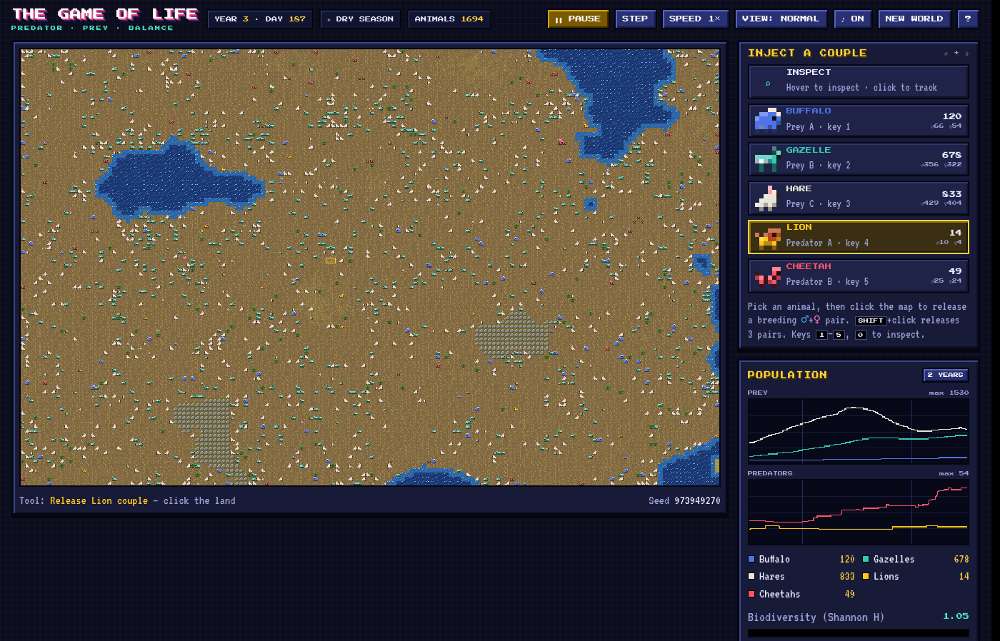

# The Game of Life — Predator & Prey

An educational, 16-bit-style ecosystem simulation in a single HTML file.
Every pixel-creature is one animal that eats, flees, hunts and searches for a mate on its own.
Population booms, crashes and predator–prey cycles emerge from those individual decisions.

[](https://lonewolf4blitzkrieg.github.io/the-game-of-life/)

**▶ Play online:** https://lonewolf4blitzkrieg.github.io/the-game-of-life/

Or open `index.html` in any modern browser. No build step and no install. It works offline too (fonts fall back to monospace).

## The species

| | Species | Breeding | Defence / strength | Notes |
|---|---|---|---|---|
| Prey A | **Buffalo** | slow (1 calf) | very resilient, herds gore attackers | most food for predators |
| Prey B | **Gazelle** | moderate (1–2) | partly resistant, fast, alarm calls | |
| Prey C | **Hare** | fast (1–3, early maturity) | weak, hides near trees/rocks | r-strategist |
| Predator A | **Lion** | slow | strongest, moderate speed, hunts cooperatively | kills rival cheetahs |
| Predator B | **Cheetah** | moderate | moderate strength, fastest (2 moves/turn) | avoids lions, picks off lion cubs |

Every birth needs a male and a female of the same species. Young predators follow their mother and share her kills.

## How to play

- **1–5**: pick an animal, then **click the map** to release a ♂+♀ couple (**Shift+click** releases 3 couples).
- **0 / Esc**: inspect tool. Hover to see an animal's age, energy and current action; click to track it.
- **Space** pause · **.** step one day · **+/−** speed (1×–16×) · **V** view mode (normal / sex / energy) · **N** new world · **M** sound · **H** help.
- Rainfall slider and wet/dry seasons change how fast grass grows.
- Complete the 8 objectives, read the field notes in the journal (they appear when something worth learning happens), and explore the **Ecology 101** tab.

## Concepts it teaches

Food chains and energy pyramids · Lotka–Volterra predator–prey cycles · r- vs K-selection · carrying capacity and seasons · competition, intraguild predation and niche partitioning · prey switching · sexual reproduction, small populations and the Allee effect · trophic cascades · the Shannon biodiversity index.

## Developer tools

The simulation core (`<script id="sim-core">`) has no DOM dependencies, so you can run it headlessly in Node:

```bash
node tools/balance.js 15 5 balanced   # years, seeds, preset: population report per half-year
node tools/sweep.js '[{}, {"lion":{"crowdMax":2}}]' 20 4   # score parameter overrides by coexistence
```

In testing with the default parameters, the Balanced Savanna kept all five species alive for 10+ years in every seed, and for 20 years in 9 of 10 seeds. Extinctions can still happen, and that is part of the lesson: reintroduce the species with the inject tool.
